# COBOL入門編

**東京システム営業5部1課**
**大井駐在オペレーター**
**1999年11月18日 再編成**

---

## 目次

### 第一章 COBOLの概説

1. [COBOLの単位](#1-cobolの単位)
2. [4つのDIVISION](#2-4つのdivision)
3. [文字セット](#3-文字セット)

### 第二章 IDENTIFICATION DIVISION（見出し部）

1. [形式（記入例）](#1-形式)

### 第三章 ENVIRONMENT DIVISION（環境部）

1. [形式（記入例）](#1-形式-1)
   - (1) [SPECIAL-NAMES](#1-special-names)
   - (2) [SOURCE-COMPUTER](#2-source-computer)
   - (3) [OBJECT-COMPUTER](#3-object-computer)
   - (4) [INPUT-OUTPUT SECTION](#4-input-output-sectionコントロールセクション)
   - (5) [FILE-CONTROL](#5-file-control)
     - ① SELECT文節 ② ASSIGN文節 ③ RESERVE文節 ④ FILE-LIMIT文節 ⑤ ACCESS MODE文節 ⑥ PROCESSING MODE文節 ⑦ ACTUAL KEY文節 ⑧ NOMINAL KEY文節 ⑨ RECORD KEY文節 ⑩ TRACK-AREA文節 ⑪ TRACK-LIMIT文節
   - (6) [I-O-CONTROL](#6-i-o-control)
     - ① RERUN文節 ② SAME文節 ③ MULTIPLE FILE TAPE文節 ④ APPLY文節

### 第四章 DATA DIVISION（データ部）

1. [形式（記入例）](#1-形式-2)
   - (1) [FILE SECTION](#1-file-section)
     - ① BLOCK CONTAINS ② RECORD CONTAINS ③ RECORDING MODE ④ LABEL RECORD ⑤ VALUE OF ⑥ DATA RECORD
   - (2) [データ記述項目](#2-データ記述項目)
     - ① WORKING-STORAGE SECTION（77・88・66レベル）
     - ② PICTURE句（9・A・X・編集-TYPE）
     - ③ VALUE文節 ④ JUST RIGHT句 ⑤ REDEFINE文節 ⑥ OCCURS文節
   - (3) [LINKAGE SECTION](#3-linkage-section)

### 第五章 PROCEDURE DIVISION（手続き部）

1. [ACCEPT](#1-accept-命令) 2. [ADD](#2-add-命令加算) 3. [SUBTRACT](#3-subtract-命令減算) 4. [MULTIPLY](#4-multiply-命令乗算) 5. [DIVIDE](#5-divide-命令除算) 6. [COMPUTE](#6-compute-命令) 7. [IF](#7-if-命令) 8. [READ](#8-read-命令) 9. [MOVE](#9-move-命令) 10. [SET](#10-set-命令) 11. [PERFORM](#11-perform-命令) 12. [GO TO](#12-go-to-命令) 13. [OPEN](#13-open-命令) 14. [CLOSE](#14-close-命令) 15. [WRITE](#15-write-命令) 16. [DISPLAY](#16-display-命令) 17. [SEARCH](#17-search-命令) 18. [STOP RUN・GOBACK](#18-stop-rungoback)

### 第六章 フロー例とコーディング例

1. [マッチング（1:1）スイッチ使用](#1-マッチング処理のフロー例11—スイッチを使用する場合)
2. [マッチング（1:1）スイッチ不使用](#2-マッチング処理のフロー例11—スイッチを使用しない場合)
3. [マッチング（1:N）スイッチ不使用](#3-スイッチを使用しない場合1n)
4. [マッチング（N:N）](#4-スイッチを使用しない場合nn—同一keyのmaxが全く予想できない場合)
5. [マッチングの説明](#5-マッチング処理の説明)
6. [コントロールブレイク](#6-コントロールブレイクのフロー例)

### 第七章 TSO

1. [ファイル関係図](#1-tso周辺のファイル関係図)
2. [ファイル説明](#2-ファイル説明)
3. [ソースからロードモジュールまで](#3-ソースからロードモジュールまで)
4. [JCLとTSOのテスト](#4-jclとtsoのテストの違い)
5. [TSOモード関係図](#5-tsoモード関係図)
6. [CLISTの作り方](#6-clistの作り方)
7. [TSOの主なコマンド](#7-tsoの主なコマンド)

### 第八章 PAD図

1. [PAD図（1:1マッチング、スイッチ使用）](#1-pad図11マッチングスイッチ使用)
2. [PAD図（1:1マッチング、スイッチ不使用）](#2-pad図11マッチングスイッチ不使用)
3. [PAD図（1:Nマッチング、スイッチ不使用）](#3-pad図1nマッチングスイッチ不使用)
4. [PAD図（N:Nマッチング）](#4-pad図nnマッチング)
5. [PAD図（コントロールブレイク）](#5-pad図コントロールブレイク)

---

## 第一章 COBOLの概説

### 1. COBOLの単位

語はCOBOL予約語、あるいはプログラマーによって定義される語のいずれかである。予約語はCOBOLコンパイラーに対し、特定の統語上意味を持っている。

プログラマーによって定義される語は、データ名やプログラム名などの項目で名前を付ける際はCOBOLの規則に従わなければならない。

### 2. 4つのDIVISION

各DIVISIONは、論理的な順序に配置される。DIVISIONのコーディングの順序は下記のとおりである。

```cobol
IDENTIFICATION  DIVISION.    （見出し部）
ENVIRONMENT     DIVISION.    （環境部）
DATA            DIVISION.    （データ部）
PROCEDURE       DIVISION.    （手続き部）
```

- **IDENTIFICATION DIVISION** では、プログラム名、プログラム作成者、作成日などを記入する。
- **ENVIRONMENT DIVISION** では、プログラムを処理する具体的な計算機の構成に関する情報、JCLのDD名とDCB名の対応づけなどを記入する。
- **DATA DIVISION** では、プログラムで扱う全てのデータの形式・性質、及び作業用エリアとして使用するエリアの定義などを記入する。
- **PROCEDURE DIVISION** では、計算機に実行させたい処理をCOBOLの命令により記入する。

### 3. 文字セット

51種類の文字から構成される。

| 文字 | 意味 |
|------|------|
| `0`, `1`〜`9` | 数字 |
| `A`, `B`〜`Z` | 英字 |
| `△` | スペース（空白） |
| `+` | 正の符号 |
| `-` | 負の符号（ハイフン） |
| `*` | 星印（アスタリスク） |
| `/` | 斜線（スラッシュ） |
| `=` | 等号 |
| `¥` | 通貨記号 |
| `:` | コロン |
| `;` | セミコロン |
| `.` | ピリオド（小数点） |
| `"` または `'` | 引用符（IBMでは `'`） |
| `(` | 左括弧 |
| `)` | 右括弧 |
| `>` | 不等号（より大きい） |
| `<` | 不等号（より小さい） |

**語の中で使用される文字**

`0`〜`9`、`A`〜`Z`、`-`（ハイフン）は、語の始めと終わりには使用できない。なお、桁数は30桁以内である。

**例:**

```
S02-INITIAL
WK-FROM.
COUNTER-AREA  など
```

---

## 第二章 IDENTIFICATION DIVISION（見出し部）

### 1. 形式

```cobol
*IDENTIFICATION DIVISION.
*PROGRAM-ID.               プログラム名．
  AUTHOR.                  プログラム作成者
  DATE-COMPILED.           コンパイル日付
  DATE-WRITTEN.            プログラム作成日
  INSTALLATION.            会社名、課名、など
  SECURITY.                情報の極秘等
  REMARKS.                 プログラムの概要処理
```

`*`の2つ（`IDENTIFICATION DIVISION`、`PROGRAM-ID`）は省略不可。他は省略可能。

コンパイル日付は機械の方でコンパイル時に入れてくれるので、プログラマーが記入する必要はない。記入した時には、機械の方の日付は無視される。

**記入例:**

```cobol
IDENTIFICATION    DIVISION.
PROGRAM-ID.       SS001601.
DATE-COMPILED.
REMARKS.          MIX DUMP.
```

なお、REMARKSは、項目中にスペースがあっても、2行になっても、全くプログラムに差し支えない。

---

## 第三章 ENVIRONMENT DIVISION（環境部）

### 1. 形式

```cobol
*ENVIRONMENT DIVISION.
*CONFIGURATION SECTION.
*SOURCE-COMPUTER.
*OBJECT-COMPUTER.
  SPECIAL-NAMES.
  INPUT-OUTPUT SECTION.
  FILE-CONTROL.
  I-O-CONTROL.
```

`*`の4つは指定しなければならない。`*`のない4つは、プログラム上あるいはファイルの都合上、指定せねばならないものもある。

**記入例:**

```cobol
ENVIRONMENT       DIVISION.
CONFIGURATION     SECTION.
SOURCE-COMPUTER.  IBM-370.
OBJECT-COMPUTER.  IBM-370.
SPECIAL-NAMES.    C01 IS F-FILE.
INPUT-OUTPUT      SECTION.
FILE-CONTROL.
  SELECT INFL ASSIGN TO UT-S-INFL.
  SELECT OTFL ASSIGN TO UT-S-OTFL.
I-O-CONTROL.
  APPLY WRITE-ONLY ON OTFL.
```

#### (1) SPECIAL-NAMES

プリントなどでファーストラインに名前を付けるものである（C01のみ使用）。

例えば、`C01 IS FIRST-LINE` と記入すると、チャネル01（C01）の名前を FIRST-LINE と定義することである。これは、プロシージャーディビジョンでプリントファイルにWRITEする際に使用される。`BEFORE` もしくは `AFTER` で FIRST-LINE と書くと、命令が実行された後、または前にプリンタのポインタがTOPを指す。詳細はWRITE命令を参照。

#### (2) SOURCE-COMPUTER

この段落は文書化の働きしかしない。コンパイルする電子計算機について記述する。通常、`IBM-9790.` などの様に記述する。

#### (3) OBJECT-COMPUTER

SOURCE-COMPUTERと同じで、実行する計算機について記述する。MEMORY SIZE や SEGMENT-LIMIT などのOPTIONがあるが、ここでは省略する。

#### (4) INPUT-OUTPUT SECTION（コントロールセクション）

個々のファイルの定義。ファイルを入れる外部記憶媒体の識別（JCLのDDとの関連付け）。1つ、又は2つ以上の入出力装置へのファイルの割り当てなどを定義するセクションで、FILE-CONTROL段落とI-O-CONTROL段落がある。

#### (5) FILE-CONTROL

ファイルを入出力装置に割り当てる。

**形式で使える文節:**

| 文節 | 説明 |
|------|------|
| SELECT文節 | ファイルに名前を与える |
| ASSIGN文節 | 外部媒体（JCL上のDD名）に割り当てる |
| RESERVE文節 | バッファの数を指定 |
| FILE-LIMIT文節 | コメントとして扱われる |
| ACCESS MODE文節 | アクセス方法（順次/ランダム）を規定 |
| PROCESSING MODE文節 | 指定してもコメントとして扱われる |
| ACTUAL KEY文節 | ランダム・アクセス時に必須 |
| NOMINAL KEY文節 | 索引付/相対ファイルのランダム・アクセス時に必須 |
| RECORD KEY文節 | 索引ファイルのアクセスに使用 |
| TRACK-AREA文節 | 索引ファイルへのランダム追加で効率化 |
| TRACK-LIMIT文節 | 直接編成ファイル作成時の最終トラック番号 |

**① SELECT文節**

SELECT文節は、プログラム中の個々のファイルに名前を与えるために使用される。

```cobol
SELECT  ファイル名 ASSIGN TO 外部名.
```

このファイル名で書いた名前は、DATA DIVISION中のFD又はSD項目を有していなければならない。

**② ASSIGN文節**

ASSIGN文節は、ファイルを外部媒体（JCL上のDD名）に割り当てるものである。

```cobol
ASSIGN  TO システム名
```

システム名の構成: `クラス（装置）－編成－名前`

- **クラス:** `DA`（大容量記憶装置）、`UT`（ユーティリティ）、`UR`（ユニットレコード）—— IBMではほとんどUTを使用する

  UT又はURに割り当てられるファイルは標準順次編成でなければならない。DAは順次編成又は直接編成のいずれでもよい。

- **装置:** 通常指定しない
  - `UT` … 2301、2302、2303、2311、2321、2314など
  - `UT` … 同上＋2400など（原文もこの行は `UT` 表記。1行目は `DA` の疑いあり）
  - `UR` … 1403、1404、1443など
- **編成:** 1文字のフィールド
  - `S` — 標準順次編成
  - `D` — 直接編成
  - `W` — REWRITEを使用時の直接編成
  - `R` — 相対編成
  - `I` — 索引編成
- **名前:** 1〜8文字までで示すDD名である

**③ RESERVE文節**

コンパイラーが割り当てられる入出力域（BUFF）の数をユーザーが修正できるようにするものである。

```cobol
RESERVE  { NO   } ALTERNATE  [ AREA  ]
         { 整数 }            [ AREAS ]
```

整数で示される偶数だけBUFFが確保される。ただし、順次アクセスにのみ有効。

**④ FILE-LIMIT文節**

コメントとして扱われるので省略する。

```cobol
FILE-LIMIT IS  リテラル-1  THRU  リテラル-2
```

**⑤ ACCESS MODE文節**

ファイルのレコードをアクセスする方法を規定する。

```cobol
ACCESS MODE IS  { SEQUENTIAL }
                { RANDOM     }
```

省略時は `SEQUENTIAL` とみなされる。

**⑥ PROCESSING MODE文節**

指定してもコメントとして扱われる。

```cobol
PROCESSING MODE  IS SEQUENTIAL
```

**⑦ ACTUAL KEY文節**

ランダム・アクセスの時には指定しなければならない。

```cobol
ACTUAL KEY  IS データ名
```

データ名は5〜259バイトの長さの固定長項目であり、DATA DIVISIONで指定しなければならない。

**⑧ NOMINAL KEY文節**

索引付ファイル及び相対ファイルをランダム・アクセスする時に指定しなければならない。

```cobol
NOMINAL KEY  IS データ名
```

データ名は1〜255バイトの長さの固定長項目で、WORKING-STORAGE SECTIONで指定できる。

**⑨ RECORD KEY文節**

索引ファイルをアクセスするために使用する。

```cobol
RECORD KEY  IS データ名
```

データ名は255バイト以下の固定長項目でなければならない。

**⑩ TRACK-AREA文節**

索引ファイルに対し、ランダム・アクセス方式でレコードを追加する場合に使用される。この文節を使用するとレコード追加の効率がよくなる。

```cobol
TRACK-AREA IS  { データ名 }
               { 整数     }
```

定義される区域は8の倍数で、32760バイト以内。

**⑪ TRACK-LIMIT文節**

直接編成ファイルの作成時、初期値化すべき最後のトラックの相対番号を示すものである。

```
TRACK-LIMIT IS 整数 TRACK(S)
```

#### (6) I-O-CONTROL

**形式:**

```
I-O-CONTROL.
  RERUN 文節
  SAME AREA 文節
  MULTIPLE FILE TAPE 文節
  APPLY 文節
```

**① RERUN文節**

チェックポイント・レコードをとることを指定するものである。

```cobol
RERUN ON  システム名
EVERY  { 整数       RECORD }
       { [END OF] { REEL } }
       {          { UNIT } }
```

- システム名: チェックポイント・レコードが**書き出される**ファイル
- ファイル名: チェックポイントの対象となる**目的の**ファイル。DATA部で定義されていなければならない

**② SAME文節**

処理中に2つ以上のファイルが同じコア記憶域を使用することを指定する。

```cobol
SAME    [ SORT   ]  AREA FOR ファイル名-1...n
        [ RECORD ]
```

**③ MULTIPLE FILE TAPE文節**

文書化のために使用する。

```cobol
MULTIPLE FILE TAPE CONTAINS ファイル名-1...n
POSITION  整数-1...n
```

**④ APPLY文節**

**ア.** `APPLY WRITE-ONLY ON ファイル名-1...n`
- Vモードのレコードをもつファイルをアウトファイルに対して使用する。この指定をした時のWRITE文は `WRITE レコード名 FROM エリア名` の形をとらなければならない。指定しないとブロッキングの使用効率が非常に悪くなる。

**イ.** `APPLY CORE-INDEX ON ファイル名-1...n`
- ランダム・アクセスの索引付ファイルに対してのみ指定できる。

---

## 第四章 DATA DIVISION（データ部）

### 1. 形式

```cobol
*DATA DIVISION.
FILE SECTION.
WORKING-STORAGE SECTION.
LINKAGE SECTION.
REPORT SECTION.
```

**記入例:**

```cobol
DATA            DIVISION.
FILE            SECTION.
FD  INFL                RECORDING MODE  IS F
                        RECORD          CONTAINS 20 CHARACTERS
                        LABEL           RECORD IS STANDARD
                        DATA            RECORD IS IN-REC.
01  IN-REC              PIC             X(20).
WORKING-STORAGE SECTION.
77  COUNTER             PIC             99.
01  IN-DATA.
  05  IN-KBN            PIC             X(5).
  05  IN-NAIYO          PIC             X(15).
LINKAGE       SECTION.
01  PARM.
  05  PARM-LL           PIC             9(3) COMP.
  05  PARM-YMD          PIC             X(6).
```

#### (1) FILE SECTION

ここでは、プログラム中で使用される外部データのDCBなどを記述する。

```cobol
FILE SECTION.
{ファイル記述項目}
{レコード記述項目}
```

**A. ファイル記述項目**

```
FD  ファイル名
  BLOCK CONTAINS 文節
  RECORD CONTAINS 文節
  RECORDING MODE 文節
  LABEL RECORD 文節
  VALUE OF 文節
  DATA RECORD 文節
  REPORT 文節
```

1つのプログラム中で25個以内のファイル記述項目を書くことができる。

**① BLOCK CONTAINS文節**

物理レコードのブロック長を指定する。

```cobol
BLOCK CONTAINS  [整数-1 TO]  { CHARACTERS }
                             { RECORDS    }
```

1レコード1ブロックのデータには、この文節を指定する必要はない。データがFIXの時は整数-2だけを指定する。データがVARIABLEの時は、整数-2はMAXのレコード長を指定し、整数-1を指定する時はMINのレコード長を記入する。例えば、`BLOCK CONTAINS 1 TO 3 RECORDS` と指定すると、最小1レコード・最大3レコードであることを意味している。

**② RECORD CONTAINS文節**

データ・レコードの大きさを指定する。

```cobol
RECORD CONTAINS  [整数-1 TO] 整数-2 CHARACTERS
```

通常、整数-2を指定する。整数-2はMAXのレコードの大きさ。整数-1を指定する時は、データがVARIABLEの時で、レコードの最小値を指定する。記入例はBLOCK CONTAINS文節と同じである。

**③ RECORDING MODE文節**

`F`、`U`、`V`、`S` を指定することができる。

```cobol
RECORDING MODE  IS モード
```

| モード | 説明 |
|------|------|
| F | 全てのレコードが同じ長さ。通常、各ブロックに入るレコード数は固定 |
| U | レコードの長さは固定/可変どちらでもよいが、各ブロックには1レコードしか入らない |
| V | レコードの長さは固定/可変どちらでもよく、1ブロックに1〜n個のレコードが収まる |
| S | レコードの長さは固定/可変どちらでもよく、1レコードが1ブロックより大きくてもよい |

U、Vモードは索引付編成及び相対編成のファイルには指定できない。Sモードは標準順次ファイル、または直接ファイルに対して指定できる。

**④ LABEL RECORD文節**

ラベルの有無を指定する。

```cobol
LABEL  { RECORD IS  }  { OMITTED       }
       { RECORD ARE }  { STANDARD      }
       { データ名-1...n }
```

- `OMITTED` — ユニット・レコード装置に割り当てられているファイルに対して必ず指定しなければならない（ただしIBMではSTANDARDで処理できる）
- `STANDARD` — ファイルに数個のラベルがついており、システム仕様に従っていることを指定。索引付編成はSTANDARDを指定しなければならない
- `データ名` — ユーザーラベルで標準外ラベル

**⑤ VALUE OF文節**

コメントとして扱われるので指定する必要はない。

```cobol
VALUE OF  データ名-1 IS  { データ名-2  }
                         { リテラル-1  }
```

**⑥ DATA RECORD文節**

FD文の後で書くデータレコードの名前を指定する。

```cobol
DATA  { RECORD IS  } データ名-1...n
      { RECORD ARE }
```

データ名を複数指定する時は、01レベルでその分をとらなければならない。

#### (2) データ記述項目

データ記述項目は、後で述べるWORKING-STORAGE SECTIONでの説明と重なる部分が多いので、簡単に述べる。

```cobol
レベル番号  { データ名 } PICTURE句
            { FILLER   }
```

レベル番号はデータの内容にレベル付けをするもので、01〜49まで指定できる。通常、01、05、10... の順で付けていく事が多い。ファイルの項目のDATA RECORD文節で指定したDATA名を、ここで01レベルで定義しなければならない。

```cobol
                        DATA RECORD   IS IN-REC と定義済み
01  IN-REC.
  05  IN-KUBUN          PIC           X(2).
  05  IN-NAIYO.
    10  IN-NAIYO-1      PIC           X(5).
    10  IN-NAIYO-2      PIC           X(10).
    10  FILLER          PIC           X(20).
```

これは、IN-RECという名前のレコードがあり、37バイトであることを示している。その内訳は、IN-KUBUNという名前のエリアが2バイトで、IN-NAIYOというエリアの中にIN-NAIYO-1というエリアが5バイト、IN-NAIYO-2というエリアが10バイトあるということである。

PICTURE句及びその他の事は後で述べる事にする。通常は、レコード名は01レベルでとり、PICTURE句を付け、内訳は書かない。実際の内訳は、WORKING-STORAGE SECTIONで記述する形が多く使用されている。

**① WORKING-STORAGE SECTION**

プログラム中でワークとして使用するエリア、INPUT/OUTPUTのエリアをコピーしたり設定したりするエリア、カウンターやスイッチのエリアを定義するセクションである。記述の方法はデータ記述項目と同じであるが、レベルに特別な物がある。66、77、88である。

特別なレベル: **66、77、88**

> **ア. 77レベル（独立項目）**
> 下位レベルをもたない。ゆえに独立項目と呼ばれる（88レベルを除く）。77レベルは、記述する時はこのセクションの最初で定義しなければならない。

> **イ. 88レベル（条件項目）**
> このレベルの項目はエリアをもたない。上位レベルでエリアを定義し、88レベルでその条件を示す。

> **ウ. 66レベル（再編成項目）**
> このレベルの項目はデータ項目のグループを再編成する項目であるが、ここでは説明を省略する。66レベルはREDEFINESの高度な用法で、レコードの再編成に使用される。

**88レベルの使用例:**

```cobol
77  FILE-SIGN           PIC           X.
  88  EOF-SIGN          VALUE         "E".
```

上記のように定義して、`"E"` という文字を FILE-SIGN へ移送する。通常このエリアに `"E"` が入ったかどうかを聞くためには `IF FILE-SIGN="E"` と記述するが、88レベルを記述しているため、`IF EOF-SIGN` と書くだけでよい。`="E"` という部分は書く必要がない。なぜなら `VALUE "E"` と定義しているため、PIC Xのエリアに `"E"` という文字が入った時だけ条件が満たされるからである。これは、各自で実際にやってみると納得できるのだが……。

**② PICTURE句**

エリアの長さ・TYPEなどを指定する句である。尚、PICTUREはPICと省略できる。

PICTUREのTYPEには **9-TYPE**、**A-TYPE**、**X-TYPE**、及び **編集-TYPE** がある。

> **ア. 9-TYPE（数字項目）**

```cobol
PIC  99.   または   PIC 9(2).
```

0〜9の数字のみを移送できる。英数字は不可（COMPUTATIONAL＝計算のみ）。長さを（）で囲んで指定する事もできるが、これはどのTYPEでも同じである。

```
PIC X(5).          PIC 9(5).
ABC△△  →×  →  △△△△△
12345   →○  →  12345
```

X-TYPEからの移送には十分注意しなければならない。

**小数点の指定:**

計算を行う上で小数点は必要である。2種類あり、エリアをとらない「仮想小数点」とエリア1バイトを必要とする「実小数点」がある。

| 種類 | 指定 | サイズ | 例 |
|------|------|--------|------|
| 仮想小数点 | `PIC 999V99.` | 5バイト | `00000` |
| 実小数点 | `PIC 999.99.` | 6バイト | `000.00` |

仮想小数点は小数点があるものとみなされる（エリアを確保しない）。実小数点はエリアが1バイト確保される。

**サイン（符号）の指定:**

計算上で＋、−のサインが必要な時がある。`S` という文字をつけて表わす。

```cobol
PIC  S99.
```

これは1バイトのエリアがとられる。

**ゾーン形式、パック形式、2進数の違い:**

```
  "11" を2バイトエリアに移した結果:

  ゾーン    F1 F1
  パック    01 1C
  2進      00 0B
          ←1バイト→
```

- **ゾーン形式:** 上位4ビットがF（ゾーン）となる。2バイトでは最大99までしか入らない
- **パック形式:** ゾーンが除かれた形。最後の4ビットが符号を表わす（C/F=プラス、D=マイナス）
- **2進数:** 16進数表示。最上位ビットが符号（1=マイナス、0=プラス）

ゾーンのデータにおいてサイン（＋、−）は最後の1バイトの上位4ビットで表わされ、その4ビットはパックに準ずる。

```
ゾーン    PIC 9(2).
パック    PIC S9(3) COMP-3.
2進       PIC S9(3) COMP-8.   （プラス・マイナスの情報）
          PIC S9(3) COMP SYNC.
```

※「COMP-8」は原文表記のまま。2進数の指定としては `COMP`（`COMP-2`）が一般的。

COMPという指定で2進のエリアであることを示すが、SYNCと指定すると境界が合わせられる。

```
  エリア
アドレス  0 1 2 3 4 5 6 7 8 9 10 11
  ①ハーフワード境界   ← 2バイト単位
  ②フルワード境界     ← 4バイト単位
  ③ダブルワード境界   ← 8バイト単位
```

2バイト単位のエリアの境界をハーフワード境界、4バイト単位をフルワード境界、8バイト単位をダブルワード境界と呼ぶ。この境界はCOBOLではあまり考える必要はないが、アセンブラだと必要になるので覚えておいてほしい。

カウンターなど、2進で指定した方が効率が良く、サイズ（桁数）が大きいものはパックの方が良い。ゾーンは数字コードのような演算をあまり必要としないエリアに向いている。

```
① 05 CTR-IN    PIC S9(7) COMP SYNC.
または
② 01 CTR-AREA          COMP SYNC.
    05 CTR-IN    PIC S9(7).
    05 CTR-OUT   PIC S9(7).
```

②の方で指定するとクリアが楽なので、通常②のような使い方をする。クリアーの方法は、プロシジャーの章で説明する。

> **イ. A-TYPE（アルファベット項目）**

```cobol
PIC  AA.
```

アルファベットとブランクの27文字のみを移送できる。ほとんど使われない。X-TYPEで代用できるからである。

> **ウ. X-TYPE（英数字項目）**

```cobol
PIC  XX.
```

COBOLで使用できる全ての文字を移送できる。したがって通常、数字が入っているがその他の文字が時折入ってくるとか、FILLERで定義されるエリアをX-TYPEで定義する。グループ項目（PIC句をもたないレベル項目）は全てX-TYPEとして扱われる。

```cobol
01  IN-REC.
  05  IN-1              PIC           S9(3) COMP-3.
  05  IN-2              PIC           A(3).
  05  IN-3              PIC           X(5).
```

上記のようなエリアが定義されている時、`MOVE SPACE TO IN-1` は使えないが `MOVE SPACE TO IN-REC` は使える。ただしSPACEを送ったあとIN-1を使用すると ABEND OC7（データエラー）となる。

> **エ. 編集-TYPE**

編集用文字として、前述の9、A、Xに加えて `B`、`P`、`－`、`＋`、`¥`、`Z`、`＊`、`V`、`0`、`、`、`．`、`CR`、`DB` がある。

| 文字 | 意味 |
|------|------|
| B | ブランク、挿入を表す |
| P | 小数点以下の桁数を表す |
| － | マイナス表示（符号表示） |
| ＋ | プラス表示（プラスの時は明示、マイナスは－が優先） |
| ¥ | 通貨記号表示 |
| Z | ZERO消去 |
| ＊ | チェック保護 |
| V | 仮想小数点 |
| 0 | ZERO表示 |
| 、 | カンマ表示 |
| ． | ピリオド表示 |
| CR | データの値が`－`の時、CRが表示される |
| DB | データの値が`－`の時、DBが表示される |

**使用例:**

| 指定 | データの値 | 結果 |
|------|------------|------|
| `PIC 99BB99BB99.` | `123456` | `12△△34△△56` |
| `PIC ZZZZZZ.` | `001234` | `△△1234` |
| `PIC Z,ZZZ,ZZ9.` | `001234` | `△△1,234` |
| `PIC -,---,--.` | `-001234` | `△△-1,234` |
| `PIC +,+++,+++.` | `-001234` | `△△-1,234` |
| `PIC +,+++,+++.` | `+001234` | `△△+1,234` |
| `PIC ¥,¥¥¥,¥¥¥.` | `12345` | `¥12,345` |
| `PIC ********.` | `12345` | `****12345` |

編集した値は計算に使用することはできない。ただし、受け項目としては使用できる。

**リスト出力例:**

```
¥1,283      -6,888,543    ***123    1△2△3△4
¥23,881      6,231      ****10    A△B△C△D
¥56        -31        ***990    E△F△3△4
```

上記のようなリストを出力したい時は、下記のように定義する:

```cobol
01  PRINT.
  05  PR-GAKU           PIC           ¥¥¥,¥¥¥,¥¥¥,¥¥¥.
  05  FILLER            PIC           X(3).
  05  PR-KASHI          PIC           --,---,---.
  05  FILLER            PIC           X(3).
  05  PR-CHECK          PIC           *****9.
  05  FILLER            PIC           X(5).
  05  PR-EDIT           PIC           XBXBXBX.
```

それぞれの項目にデータを移送して、PRINTをWRITEする。

編集項目は主にプリントエリアの編集時に用いられる。`Z`、`¥`、`、`、`－`、`．` は通常よく使用するので慣れておいてもらいたい。

DB、CRについては:

```cobol
PIC  9(5) DB.
PIC  9(5) CR.
```

マイナスの時のみ右端にDB、CRという文字が出力される。

```
-999 → 999DB    999CR
+999 → 999△△    999△△
```

**③ VALUE文節**

```cobol
VALUE  IS "リテラル"
```

```cobol
05  A                   PIC           X(11).
                        VALUE         "** START **".
```

`VALUE IS` の `IS` は省略できる。この時、Aというエリアには `"** START **"` というリテラルをMOVEした結果と同じになる。VALUEは、実行時にデータ名にMOVEせず、コンパイル時に初期値として定義しておきたい場合（テーブル作成など）によく使用される。

**④ JUST RIGHT句**

通常、X-TYPE・A-TYPEで定義されているエリア内にデータを移送する時は左詰めとなる。これを右詰めに処理させようというのがこの定義である。

```cobol
05  A  PIC  X(10) JUST RIGHT.
```

```
PIC X(8)              :  A B C △ △ △ △
PIC X(8) JUST RIGHT   :  △ △ △ △ A B C
```

この項目は基本項目に対してだけ指定できる。

**⑤ REDEFINE文節**

一度定義したエリアに対して違った形で定義し直すものであり、新たにエリアは取れない。あくまでも同じエリアである。

```cobol
05  A                   PIC           X(10).
05  A-R                 REDEFINES     A.
  10  B                 PIC           9(5).
  10  C                 PIC           S9(5).
  10  D                 PIC           X(1).
05  A-RR                REDEFINES     A.
  10  E                 PIC           X(3).
```

何度でも再定義してかまわない。再定義するバイト数が再定義されるエリアのバイト数よりも大きくすることはできないが、小さい分には構わない。

上記の例では、エリアを使用する時にA、B、Cなど、どれを参照するかによって、エリアのもつTYPEが決定される。

このREDEFINES文節は日付によく使われる:

```cobol
05  A-YYMMDD.
  10  A-YYMM.
    15  A-YY            PIC           X(2).
    15  A-MM            PIC           X(2).
  10  A-DD              PIC           X(2).
05  A-YYMMDD-R          REDEFINES     A-YYMMDD.
  10  A-YY-R            PIC           9(2).
  10  A-MMDD.
    15  A-MM-R          PIC           9(2).
    15  A-DD-R          PIC           9(2).
```

上記のように指定すると、同じエリアをX-TYPEでも9-TYPEでも使用できる。（YYMMDD＝年月日）

**⑥ OCCURS文節（テーブル）**

反復するデータを定義するものである。

```cobol
OCCURS  整数 TIMES
  (DEPENDING ON データ名-1)
  { ASCENDING  } KEY IS データ名-2
  { DESCENDING }
INDEXED BY  指標名
```

**例1:**

```cobol
05  A                   OCCURS        30 TIMES
                        INDEXED BY    A-X1.
  10  B                 PIC           X(1).
```

Bというエリアが30個あり、A-X1というインデックスで参照できる。実際にBのエリアを参照する時は `B(1)`、`B(2)` または `B(A-X1)` のような使い方をする。

**例2:**

```cobol
05  A                   OCCURS         30 TIMES
                        ASCENDING KEY  IS A-KEY
                        INDEXED BY     A-X1.
  10  A-KEY             PIC            X(3).
  10  A-NAIYO           PIC            X(10).
```

A-KEYが1番目から30番目まで昇順であると定義している。これはSEARCH命令に関連してくる。

**DEPENDING ON:** この句を指定する必要が生じるのは、テーブルの長さが実行時までわからない場合（VBデータなど）である。

OCCURS項目で作成されるテーブルは3次元まで許される。

**例3:**

```cobol
05  A                   OCCURS        3 TIMES
                        INDEXED BY    A-X1.
  10  B                 OCCURS        5 TIMES
                        INDEXED BY    B-X1.
    15  C               OCCURS        2 TIMES
                        INDEXED BY    C-X1.
      20  D             PIC           X(20).
```

Dという20バイトのエリアが3×5×2=30個、すなわち600バイトのエリアがとられる。参照は `D(1, 1, 1)` または `D(A-X1, B-X1, C-X1)` のようにする。

このようなテーブルは、VALUE句をもっているエリアをREDEFINEしてテーブルにしたり、集計用のエリアとして定義する事が多い。

**例4:**

```cobol
05  A                   PIC           X(10)
                        VALUE         "ABCDEFGHIJ".
05  A-R                 REDEFINES     A.
  10  B                 OCCURS        10 TIMES
                        INDEXED BY    B-X1.
    15  C               PIC           X(1).
```

このように定義すると、B-X1の値を変えることによりAの中の任意の1文字を参照できる。例えば `C(3)` は `"C"` であり、`B-X1` に5をSETすれば `C(B-X1)` は `"E"` である。

#### (3) LINKAGE SECTION

外部から渡されてくるデータ（パラメータ）、上位モジュールから渡されてくるデータを定義する場所である。基本的にはWORKING-STORAGE SECTIONの定義方法と同じである。

パラメータとして渡ってくるエリアを定義する時は、DATAの他にそのDATAの長さが入ってくるエリア2バイトを定義しなければならない。

```cobol
01  PARM.
  05  PARM-LL           PIC           9(3) COMP.
  05  PARM-YMD          PIC           X(6).
```

これは、パラメータとして入ってくるのはPARM-YMDで6バイトである。この6バイトという長さがPARM-LLへ付加されてプログラム中へ入ってくる。LLのエリアは名前を付ける必要はなく `FILLER PIC X(2).` でもよい。

---

> ### ☆ 息抜き ☆
>
> **《太ったゼロとやせたゼロ》**
>
> プログラム中には太ったゼロ（O）とやせたゼロ（0）がある。文法のミスはないはずなのに、コンパイルが通らない。よくよく見てみると、何と……`MOVE` が `M0VE` となっているではないか。いやはや、やせたゼロがじゃまをしていたのか！
>
> こんな事はJCLでもあるんじゃないかな？ このミスをなくすように、コーディングの際はOと0をわかりやすく書こう。

---

## 第五章 PROCEDURE DIVISION（手続き部）

このDIVISIONでは、実際にやる処理をCOBOLの命令を使って定義する場所である。

COBOL命令中、主な命令:

| 算術命令 | 文字列命令 | ファイル命令 | 制御命令 |
|---------|---------|---------|--------|
| ADD | MOVE | READ | IF |
| SUBTRACT | EXAMINE | WRITE | ELSE |
| MULTIPLY | DISPLAY | OPEN | PERFORM |
| DIVIDE | ACCEPT | CLOSE | GO TO |
| COMPUTE | REMAINDER | SEARCH | STOP RUN |
|  |  | AT END | GOBACK |
|  |  | BEFORE |  |
|  |  | AFTER |  |
|  | CALL |  |  |

### 1. ACCEPT 命令

```cobol
ACCEPT  データ名  [FROM { SYSIN   }
                        { CONSOLE }
                        { 記憶名  }]
```

データ名はWORKING-STORAGE SECTIONで定義済みのエリア。FROMを書かないとSYSINからの入力とみなされる。

```cobol
05  A                   PIC           X(5).  ← ABCDE（カード）
ACCEPT  A.                                   ← //SYSIN DD *
```

この命令でAというエリアには `"ABCDE"` が入る。

### 2. ADD 命令（加算）

**ア. `ADD 識別名-1...(n) TO 識別名-2...(n) [ROUNDED]`**

TOの左側に書いたエリアの内容が右側のエリアに足し込まれて、右側のエリアの値が結果と置き換わる。

```cobol
05  A                   PIC           9(3)V9(4).  ... 83.235
05  B                   PIC           9(4)V9(2).  ... 11.46
```

```cobol
ADD  A B  TO  (B) ROUNDED.
  結果 B = 106.（小数第3位四捨五入）
```

**イ. `ADD 識別名-1...(n) GIVING 識別名-2...(n) [ROUNDED]`**

GIVINGの左側のエリアの内容が全て加算されて、右側のエリアへストアされる。

```cobol
05  A                   PIC           9(2).  ... 10
05  B                   PIC           9(3).  ... 30
05  C                   PIC           9(4).  ... 0
```

```cobol
ADD  A B  GIVING  C.
  結果 C = 40（A, Bは保存）
```

```cobol
ADD  A B  GIVING  B.  ← 同じ結果が得られる
ADD  A    TO      B.  ←
```

```cobol
ADD  A B C  TO  D E F.
```

この命令を行うと、A+B+CがD、E、Fにそれぞれ加算される。

```cobol
ADD  1  TO  IN-CTR.
```

インプット件数、ライン数をカウントする時にこの形式を使う。

### 3. SUBTRACT 命令（減算）

**ア. `SUBTRACT 識別名-1...(n) FROM 識別名-2...(n) [ROUNDED]`**

FROMの左側のエリアの内容を全て加算して、右側のエリアの値から減算し、右側のエリアの内容が結果と置き換わる。

```cobol
05  A                   PIC           9(2).  ... 10
05  B                   PIC           9(3).  ... 15
05  C                   PIC           9(4).  ... 100
```

```cobol
SUBTRACT  A B  FROM  C.
  結果 C = 75（A, Bは保存）
```

**イ. `SUBTRACT 識別名-1...(n) FROM 識別名-2...(n) GIVING 識別名-3 [ROUNDED]`**

FROMの左側のエリアの内容を全て加算し、右側のエリアから減算して、結果はGIVINGで指定しているエリアへストアされる。

```cobol
05  A                   PIC           9(2)V9(2).  ... 10.01
05  B                   PIC           9(3)V9(2).  ... 33.25
05  C                   PIC           9(4)V9(1).  ... 100.0
```

```cobol
SUBTRACT  A  FROM  B GIVING C ROUNDED.
  結果 C = 23.2（小数第2位四捨五入）
```

通常、ADDもSUBTRACTもGIVINGオプションを使うような時は、便利なCOMPUTE命令を使用する事が多い。

### 4. MULTIPLY 命令（乗算）

**ア. `MULTIPLY 識別名-1 BY 識別名-2 [ROUNDED]`**

BYの左側に書いたエリアの内容が右側のエリアに乗算され、結果が置き換わる。

```cobol
05  A                   PIC           9(2)V9(1).  ... 3.1
05  B                   PIC           9(3)V9(1).  ... 24.1
```

```cobol
MULTIPLY  A  BY  B ROUNDED.
  結果 B = 74.7（小数第2位四捨五入）
```

**イ. `MULTIPLY 識別名-1 BY 識別名-2 GIVING 識別名-3 [ROUNDED]`**

この形式を用いると、ADDやSUBTRACTと同様に結果はGIVINGの後に指定したエリアへストアされ、乗数・被乗数共に保存される。

```cobol
05  A                   PIC           9(2).  ... 10
05  B                   PIC           9(2).  ... 22
05  C                   PIC           9(4).  ... 0
```

```cobol
MULTIPLY  A BY B  GIVING  C.
  結果 C = 220（A, Bは保存）
```

GIVINGのエリアは数字編集項目でもよい。

```cobol
05  A                   PIC           9(2).  ... 10
05  B                   PIC           9(2).  ... 22
05  C                   PIC           Z(4).
```

```cobol
MULTIPLY  A BY B  GIVING  C.
  結果 C = △220
```

### 5. DIVIDE 命令（除算）

**ア. `DIVIDE 識別名-1 INTO 識別名-2 [ROUNDED]`**

INTOの右側のエリアの内容が左側のエリアで除算され、右側のエリアの値が結果と置き換わる。

```cobol
05  A                   PIC           9(2)V9(1).  ... 2.9
05  B                   PIC           9(3)V9(2).  ... 32.28
```

```cobol
DIVIDE  A  INTO  B ROUNDED.
  結果 B = 11.13（小数第3位四捨五入）
```

**イ. `DIVIDE 識別名-1 INTO 識別名-2 GIVING 識別名-3 [ROUNDED] [REMAINDER 識別名-4]`**

REMAINDERは余りを求めるオプションである。INTOの左側のエリアの値で右側のエリアの値を除算し、結果をGIVING句のエリアへストア、REMAINDER句のエリアへ余りをストアする。

```cobol
05  A                   PIC           9(2).  ... 13
05  B                   PIC           9(3).  ... 100
05  C                   PIC           9(2).
05  D                   PIC           9(2).
```

```cobol
DIVIDE  A  INTO  B GIVING C REMAINDER D.
  結果 C = 7、D = 9
```

**ウ.** イの形式中のINTOをBYに変えると、除数と被除数の関係が逆転する。この時気をつけなければならないのは、除数・被除数のどちらかにリテラルを用いる場合である。

### 6. COMPUTE 命令

ADD、SUBTRACT、MULTIPLY、DIVIDEなどの機能を算術文を用いて指定できる。

**記号:** `=`（イコール）、`*`（乗算）、`/`（除算）、`()`（優先度）、`+`（加算）、`-`（減算）、`**`（べき乗）

```cobol
COMPUTE  識別名-1  [ROUNDED] = 算術演算式
```

例えば `C = (A + B) / (B - E) * D` と書きたい場合:

```cobol
COMPUTE  C = ((A + B) / (B - E)) * D.
```

ただしCOMPUTE命令には余りを求めるオプションはない。余りを必要とする時にはDIVIDE命令を使用しなければならない。

```cobol
COMPUTE  A = 20.
```

上記は `MOVE 20 TO A.` と同じ結果。ただしCOMPUTE命令のAのエリアは9-TYPEでなければならない。受項目（`=` の左側）は数字編集項目であってもかまわない。

**実行順序:** 括弧 → べき乗 → 乗算/除算 → 加算/減算（同レベルは左から右）

**比較:** `A = B × C × D⁶ + 6 - E` を2通りの方法で書いた場合:

```cobol
COMPUTE:
COMPUTE   A = B * C * D ** 6 + 6 - E.

個別命令:
MULTIPLY  D BY D  GIVING  A.
MULTIPLY  D       BY      A.           （4回繰り返す）
MULTIPLY  B       BY      A.
MULTIPLY  C       BY      A.
ADD       6       TO      A.
SUBTRACT  E       FROM    A.
```

**ON SIZE ERROR オプション（算術命令共通）:**

```cobol
MULTIPLY         A  BY  B
  ON SIZE ERROR  GO TO ERR-SHORI.
```

AまたはBのエリアでオーバーフローが発生したらERR-SHORIというルーチンへ飛んでいく。ADD・SUBTRACT・MULTIPLY・DIVIDE・COMPUTEの各算術命令でこのオプションが使える。

### 7. IF 命令

条件によって処理を変えることができる。

```cobol
IF    条件  ステートメント-1  NEXT SENTENCE
ELSE  ステートメント-2  NEXT SENTENCE
```

```cobol
IF               A = B
  PERFORM        S03-EQUAL-SHORI  THRU  S03-EXIT
ELSE
  NEXT SENTENCE.
```

AとBのエリアの内容が等しければS03-EQUAL-SHORIからS03-EXITまでの処理を行う。等しくなければ何もしない。ELSE NEXT SENTENCEは省略できるが、IFとELSEは対にした方が分かりやすいので書いておく方が望ましい。

**ネスティング（入れ子方式）:**

```cobol
IF        A = B
  IF      B NOT = C  → ネスティング
    IF    C = D
      命令
    ELSE
```

### 8. READ 命令

ファイルを実際にプログラム内に読み込んでくる命令。READ命令を実行する前にOPEN命令が実行されていなければならない。実行されていないと、ABEND=U3706などでプログラムは異常終了する。

```cobol
READ   ファイル名  [INTO データ名]
  AT END  命令ステートメント.
```

```cobol
READ       INFL1  INTO  IN-DATA
  AT END
    MOVE   '1'    TO    SW-EOF
    GO TO  READ-END.
```

INTOを使わないとFILE SECTIONで定義した01レベルのエリア内にデータは読み込まれる。INTOオプションは READ + MOVE に相当する。

### 9. MOVE 命令

```cobol
MOVE  識別名-1  TO  識別名-2...(n)
```

```cobol
MOVE  ZERO  TO  A B C.  ← A, B, Cがゼロクリアされる
MOVE  A     TO  B.      ← Aの内容がBに移される
```

MOVEステートメントはインデックスには使えない。インデックスにはSET命令を使う。

### 10. SET 命令

インデックスに値をセットしたり、加算・減算をするものである。

```cobol
SET インデックス名 TO       識別名
SET  〃              UP BY  識別名
SET  〃                     DOWN BY 識別名
```

```cobol
SET  IDX1  TO       1.  ← IDX1に1がセットされる
SET  IDX1  UP BY    1.  ← IDX1が+1される
SET  IDX1  DOWN BY  3.  ← IDX1が-3される
```

右側のものが左側へセットされる（MOVEとは逆）。

### 11. PERFORM 命令

プログラムを処理別にセグメント化すると見やすくなるだけでなく、修正・デバッグも容易になる。このセグメント化した処理を連結する時に、このPERFORM命令を使用する。

```cobol
PERFORM  処理手順名-1  [THRU 処理手順名-2]
                       [識別名-1 TIMES]
```

これは、処理手順名-1から処理手順名-2までを識別名-1回繰り返すという意味である。処理手順名-2を指定していないと、次の処理手順名が出てくるまでの処理を行う。

```cobol
  PERFORM  S03-READ  THRU  S03-EXIT.

S03-READ.                             ← このブロックの処理を実行
  ...
S03-EXIT.
  EXIT.
```

**UNTILオプション:**

```cobol
  PERFORM      S04-SHORI  THRU  S04-EXIT
    UNTIL      SW-END = 'E'.

S04-SHORI.
    READ       INFL
      AT END
        MOVE   'E'        TO    SW-END
        GO TO  S04-EXIT.
S04-EXIT.
  EXIT.
```

ファイルエンドになるまでS04-SHORIからS04-EXITまでを繰り返す。

**VARYINGオプション（複雑なループ処理）:**

条件付PERFORM命令でもっと複雑な処理もできる。ある値をアップしながら条件を1〜3個調べ、全ての条件を満たすまでPERFORM命令が繰り返されるというものである。処理を件数でブレイクしたり、年令でブレイクしたり、テーブルで持っているデータのブレイクをしたりする時に非常に便利である。

```cobol
PERFORM    処理手順名-1  THRU  処理手順名-2
  VARYING  指標名-1 FROM 識別名-2 UNTIL 条件-1
  BY       識別名-3
  [AFTER   指標名-4 FROM 識別名-5
  BY       識別名-6 UNTIL 条件-2
  [AFTER   指標名-7 FROM 識別名-8
  BY       識別名-9 UNTIL 条件-3 ]]]
```

```cobol
PERFORM  S05-SHORI  THRU  S05-EXIT
  VARYINGIDX1 FROM 1
    BY   10 UNTIL A > B
  AFTER  IDX2 FROM 1
    BY   10 UNTIL B > C.
```

2次元テーブル処理に向いている。

**動作の順序:**

1. IDX1とIDX2が1にSETされる
2. 条件 `A > B` が調べられ、**真（条件成立）ならばループを抜け**、この命令の次のステートメントへ移る
3. **偽（条件未成立）ならば**、条件 `B > C` が調べられ、IDX2は1にSETされ、IDX1が1増やす
4. IDX1が10を超えたら、次のステートメントへ移る
5. 超えていなければ、2〜4が繰り返される
6. 条件 `B > C` が偽（未成立）ならば、`S05-SHORI` から `S05-EXIT` が1回実行される
7. IDX2の値が1増やし、また条件 `B > C` が調べられる
8. 以上の処理が繰り返される

条件付PERFORM命令を使うと、ある値をアップしながら条件を調べ、全ての条件を満たすまでPERFORMが繰り返される。テーブルのデータのブレイクや集計などに非常に便利であり、このような意味でテーブル処理に向いているといえる。

**注意:** 一般にメイン処理はPERFORM命令とIF文で組み立てられる事が多い。PERFORMした先から別のセグメントへブランチすることは望ましくない（後からの解析がやりにくくなる）。

```cobol
S04-SHORI.   左のようなプログラムの組み立ては
    GO TO  S05-SUB.   望ましくない。GO TO文はそのセグメント
                    内にとどまる方が望ましい。
S04-EXIT.
  EXIT.
S05-SUB.
S05-EXIT.
  EXIT.
```

### 12. GO TO 命令

```cobol
GO TO  処理手順名
```

```cobol
S04-SHORI.
    GO TO  S04-02.
S04-01.
    GO TO  S04-03.
S04-02.
    GO TO  S04-01.
S04-03.
S04-EXIT.
  EXIT.
```

GO TO文は1つの処理内で使うのが望ましい。他の処理へブランチさせてもプログラム的には問題ないが、デバッグ・修正が困難になる。

**DEPENDING ONオプション:**

```cobol
GO TO     処理手順名-1
          処理手順名-2
          処理手順名-n  DEPENDING ON  識別名
```

```cobol
MOVE   A  TO  WK-DEP.
GO TO  S03-01
     S03-02
     S03-03 DEPENDING ON WK-DEP.
```

WK-DEPに `1`〜`3` の値が入っていれば、それぞれS03-01、S03-02、S03-03へブランチする。該当が無ければGO TO文は実行されず次のステートメントへ移る。

なおWK-DEPは、WORKING-STORAGE SECTIONで定義済みの9-TYPEのエリアである。

### 13. OPEN 命令

ファイルをREAD/WRITEできるようにあらかじめ開いておく命令。READ/WRITEの前に実行しておかなければならない。

```cobol
OPEN  INPUT  ファイル名-1...(n)  ← READだけ
OPEN  OUTPUT ファイル名-2...(n)  ← WRITEだけ
OPEN  I-O    ファイル名-3...(n)  ← 両方
```

一度OPENするとCLOSE命令を実行するまではOPEN命令は実行できない。通常、INITIAL処理で行う事が多い。I-OでREAD/WRITEをする時はインプットとして読まれたデータに書いていくので、インプットデータは残らない点に注意。

### 14. CLOSE 命令

この命令は、既に開かれているファイルを閉じる命令である。この命令を実行する前には、必ずOPEN命令が実行されていなければならない。

```cobol
CLOSE  ファイル名-1...(n)
```

```cobol
CLOSE  INFL OUTFL.
```

INPUT/OUTPUTの指定はいらない。CLOSEした後、ファイルのREAD/WRITEを行う時は再度OPENを実行しなければならない。

なお、CLOSE命令には、リワインドさせる／させないなどのオプションがいくつかあるが、ここでは省略する。

### 15. WRITE 命令

この命令は、OUTPUTもしくはI-Oで開かれたファイルへ書き出しを行う命令である。（形式はリスト以外のファイル）

```cobol
WRITE  レコード名  [FROM 識別名]
```

FROMを使うと識別名の内容がレコード名へMOVEされてからWRITEされる（READ～INTOと同じ考え方: MOVE + WRITE）。

```cobol
FILE SECTION.
FD  OUTFL.
01  OUT-REC             PIC           X(100).

WORKING-STORAGE SECTION.
01  OUT-DATA.
  05  OUT-KEY.

PROCEDURE DIVISION.
WRITE  OUT-REC  FROM  OUT-DATA.
```

これは以下と同じ:

```cobol
MOVE   OUT-DATA  TO  OUT-REC.
WRITE  OUT-REC.
```

**リスト出力のWRITE:**

リストにWRITEする方法は、大きく分けて2種類ある。1つは1ラインプリントした後で改行を行う（BEFORE）方法、もう1つは改行を行った後プリントする（AFTER）方法である。

```cobol
WRITE  レコード名  [FROM 識別名]
                   [BEFORE  ADVANCING 識別名 LINES]
                   [AFTER   ADVANCING 識別名 LINES]
```

識別名の中に入っている数の分だけラインを飛ばす。ここにSPECIAL-NAMESで指定した `C01 IS 〜` の名前を使うと、改頁されてプリントできる行の最初の行を指す。通常、ADVANCINGとLINESという語は省略して使う。

BEFOREとAFTERの違い:

```
ポイントPの位置:   P ← ──
                   A行
                   B行
                   C行

BEFORE 2 の場合:
  "*** テスト プログラム ケッカ ***"  がA行に書き出される
  ポインタはCを指す（書き出した行を含む2+1行先）

AFTER 2 の場合:
  ポインタはまず2行先に移る（B行）
  "*** テスト プログラム ケッカ ***"  がB行に書き出される
  ポインタはCを指す
```

効率としてはBEFOREの方が良い。プリントしてプリンタが改行している間にプログラムでは次にプリントする内容をセットできるからである。1つのプログラム中ではどちらかに統一した方が間違いが少なくて良い。

### 16. DISPLAY 命令

```cobol
DISPLAY  識別名-1...(n)  [UPON { CONSOLE  }
                               { SYSOUT   }
                               { SYSPUNCH }
                               { SYSPCH   }]
```

UPON句が省略されるとSYSOUTとみなされる。

| 出力先 | 長さ制限 |
|--------|----------|
| SYSOUT | 120桁 |
| CONSOLE | 100桁 |
| SYSPUNCH | 72桁 |

```cobol
DISPLAY  "*** PROGRAM ERR ***"  UPON  CONSOLE.
```

```
DISPLAY "ERROR△△" "CODE=" WK-CODE.
```
WK-CODEに `'001'` が入っていると仮定すると、SYSOUT上に `"ERROR△△CODE=001"` とプリントされる。

CONSOLE以外は、JCL上でDDカードを指定しておかなければならない。入出力件数の出力に良く使われる。

### 17. SEARCH 命令

テーブルで取られたエリア内から、あるKEYに基づいて必要なデータを探し出す命令。

```cobol
SEARCH  テーブル名  [AT END 命令ステートメント-1]
  WHEN  条件 命令ステートメント-2
```

テーブル名は、エリアの上でOCCURS句が付いている項目である。SEARCHを使わずにIFでLOOPさせるやり方もある。

```cobol
05  A-OCCUR             OCCURS        100 TIMES
                        INDEXED BY    A-X1.
  10  A-KEY             PIC           X(3).
  10  A-NAIYO           PIC           X(25).
05  WK-KEY              PIC           X(3).
05  WK-DATA             PIC           X(25).
```

```cobol
SET       A-X1            TO  1.
SEARCH    A-OCCUR
  AT END  GO TO SEARCH-END
WHEN      WK-KEY = A-KEY (A-X1)
  MOVE    A-NAIYO (A-X1)  TO  WK-DATA.
```

SEARCH命令を実行する前に必ずインデックスに値をセットしなければならない。このサーチ命令は、A-OCCURというエリアのA-KEYのn番目がWK-KEYと等しいものを探し出して、そのn番目のA-NAIYOをWK-DATAへ移す。テーブル上に条件に合うものが無ければ、SEARCH-ENDという処理手順名の所へブランチする。

**IF文のLOOPでも同等の処理:**

```cobol
  SET        A-X1            TO     1.
S03-SEARCH.
  IF         A-X1 > 100
    GO TO    S03-SEARCH-END
  ELSE
    IF       A-KEY (A-X1) = WK-KEY
      MOVE   A-NAIYO (A-X1)  TO     WK-DATA
    ELSE
      SET    A-X1            UP BY  1
      GO TO  S03-SEARCH.
```

SEARCHの方がステートメント数が少なく、S03-SEARCHという処理手順名をとる必要が無い。どちらを使うかはケースバイケースで使い分けて欲しい。

### 18. STOP RUN、GOBACK

- **STOP RUN** — プログラムの停止。リンクを必要としない単体のモジュールで使用する
- **GOBACK** — 制御を上位モジュールへ返す。リンクを必要とし、かつメインモジュールでない时使用（メインはSTOP RUN）

基本的には、今まで述べてきた命令詳を使用してプロシジャーを作成する。まだまだ命令はあるが、とりあえず基本としてここに述べた命令は覚えておいてもらいたい。

> **CALL命令:** `CALL モジュール名 USING エリア名` という形で使用する。CALL命令は別のプログラム（モジュール）をInvokeする命令で、USING句でパラメータを渡す。CALL命令を使うと、そのプログラムは他のプログラムを必要とするため、リンクという手続きを行ってロードモジュールを作成しなければならない。本教材の範囲を超えるので詳細は別の参照書を参照されたい。

---

## 第六章 フロー例とコーディング例

ここでは、処理の基本であるマッチング処理とコントロールブレイク処理を実際のフローとコーディング例で紹介する。

なお、これらのフローは書物より引用した物ではない為、もっとよいフローがあるかもしれない。

### マッチング処理とは

2つ以上のファイルをつきあわせ、あるKEYによってファイルに更新をかけるような処理である。ファイルの個数・KEYの個数によって1:1、1:N、1:1:1、1:1:Nなどの処理がある。

### コントロールブレイク処理とは

ファイル中のあるKEYが変化した時点で、それまでとは違った処理を行う事をコントロールブレイクと呼ぶ。明細を出しながら支社・営業部・支部のトータルを出力するのような処理である。

---

### 1. マッチング処理のフロー例（1:1）— スイッチを使用する場合

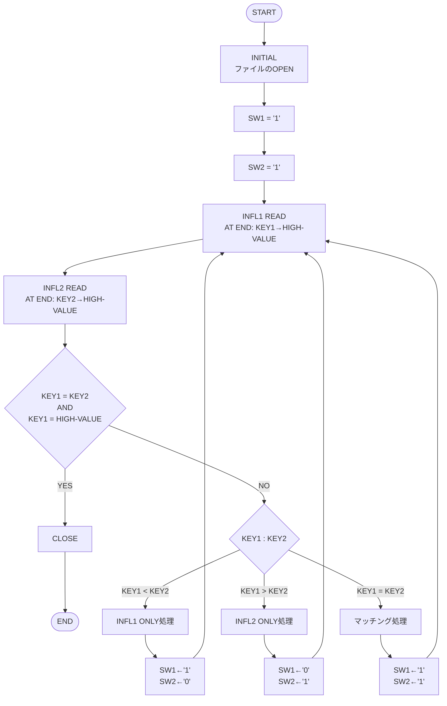

**前提条件:**
- INFL1、INFL2の各KEYは昇順にSORTされている
- 同一のKEYは同一ファイル上には存在しない
- KEY1はINFL1のKEY、KEY2はINFL2のKEY

---

### 2. マッチング処理のフロー例（1:1）— スイッチを使用しない場合

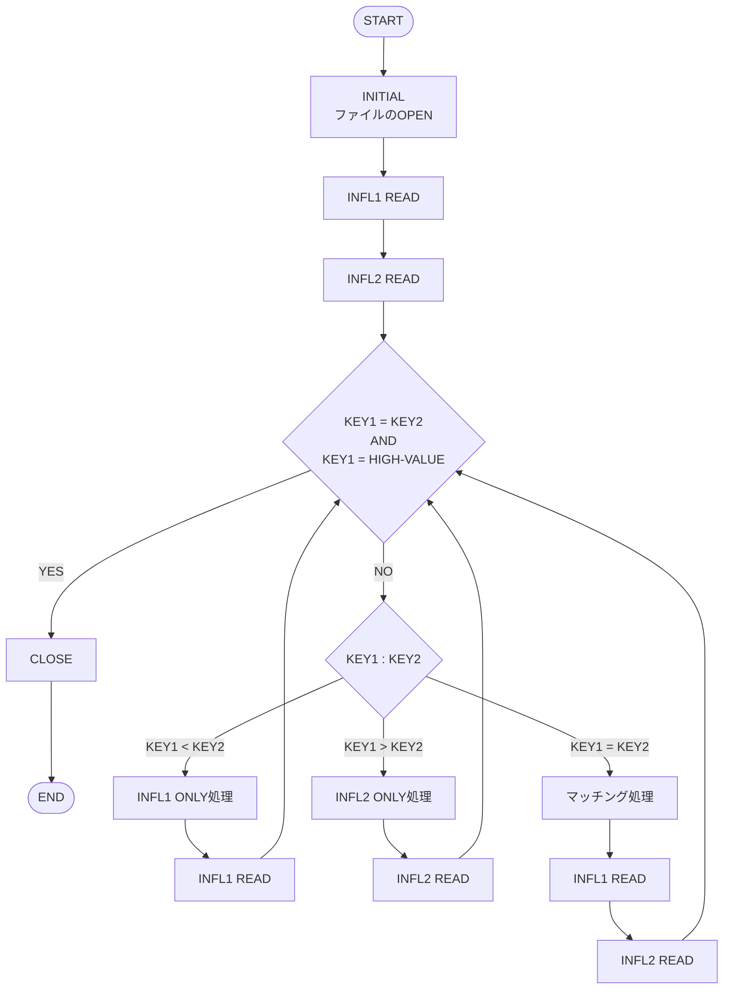

**《説明》**

スイッチを使用する場合も使用しない場合も基本的には同一である。この「マッチング処理」という所で、ファイル（INFL2）を更新しPUTする。このINFL1はマスターファイル、INFL2はトランザクションファイルを意味している。

マッチング処理で注意しなければならないのは、前提条件（ソート順、KEYの存在など）と、ファイルREADするタイミングとPUTするタイミングである。これはKEYが1:1、1:N、N:Nともに共通している。

---

### 3. スイッチを使用しない場合（1:N）

> INFL1…1（マスター）、INFL2…N（トランザクション）

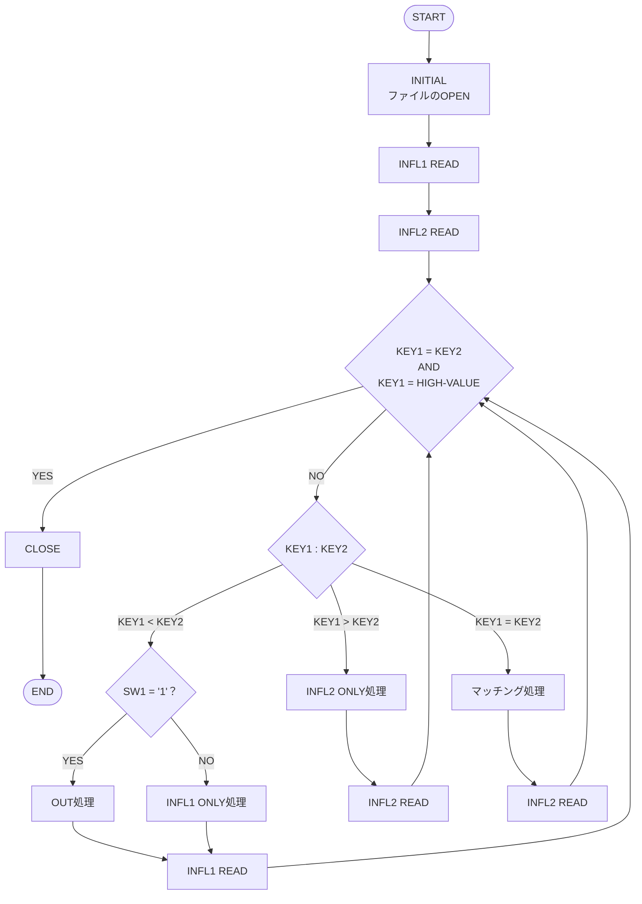

**説明:** マッチング処理ではファイルのPUTは行わず、SW1に`'1'`を立てる。このスイッチは更新処理を行ったことを示す。OUT処理でファイルのPUT処理を行う。ただし、このフローはINFL1がマスターで、マスターに更新をかけて新マスターを作成するフローである。マスターがINFL2の場合、OUT処理は不要となる。しかし、通常マスターには同一KEYが複数存在することは少ないので、このフロー処理で良い。SW1のクリアはOUT処理で行う。

---

### 4. スイッチを使用しない場合（N:N）— 同一KEYのMAXが全く予想できない場合

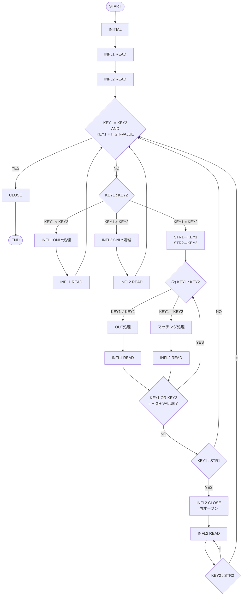

---

### 5. マッチング処理の説明

> マッチングとは、複数のファイルをあるKEYによって照合させ、同一KEY同士の処理を行い、ファイルを更新することをいう。一般には、旧（更新前）マスターとトランザクションファイル（取引ファイル）を照合させ、トランザクションファイルの内容によってマスターの内容を更新して新マスターを作成する。その際、エラーのデータはエラーファイルに出力し、同時にリスト件数表を出力する。

**例（B表）:**

例えば、マスターファイルのKEYとトランザクションのKEYをB表の様に仮定すると、マスターファイルの1件目に更新をかけようとすると、トランザクションの1件目と2件目をREADしなければならない。又、3件目のトランザクションの'05'というKEYはマスター方にはない為、新しくマスターの'04'と'06'の間にインサートする事になる。こうして新マスターを作成する。

| 件数 | マスター | トランザクション | 説明 |
|------|----------|------------------|------|
| 1 | 01 | 01 | → 01 更新をかける |
| 2 | 02 | 01 | |
| 3 | 03 | 05 | → 02 該当なし |
| 4 | 04 | 06 | → 03 |
| 5 | 06 | 06 | → 04 |
| 6 | 07 | 07 | → (05) ← マスターにないからインサート |
| 7 | 09 | 08 | → 06 |
| 8 | 10 | 09 | |

したがって、通常のマスター更新処理の新マスターは件数は増えることはあっても減ることはない（DELETE処理が入っている場合は例外）。

**N:Nマッチングについて:**

- N:Nのマッチング処理で、マスター及びトランザクションのKEYの両方とも同一KEYの個数のMAXがまるで分からない時、このフローのようにオープン・クローズを繰り返し、あたかも1:Nのマッチング処理を行うかのように処理を行う。
  - このSTR1、STR2というのは、KEYが変わる直前のKEYの値をストアしておくエリアである。
- マスターもしくはトランザクションのKEYのどちらかのKEYのMAXがわかっていて、且つRECORD-LENGTHとMAX件数を乗じた値のレングスがワーク上でとりうる値であれば、まずKEYが変わるまでワーク上へストアし続け、KEYが変わった時点でそのワークとファイルのマッチングを行う。これは1:Nのマッチング処理と同様の処理を行うことができる。
  - このフローは各自で作成してみるとよい。
- N:Nのマッチング処理というのはあまりないので、1:Nのフローを完全にマスターした方が良い。N:Nは1:Nの応用である。また、1:1:1、1:1:Nのような多数ファイルのマッチング処理も、基本は1:Nである。

---

### 6. コントロールブレイクのフロー例

**プリントルーチン（53ラインを超えたら見出しを打つ）:**

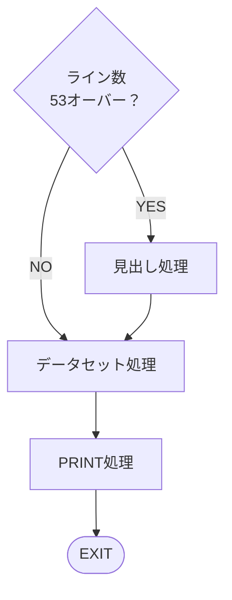

ライン数をカウントして53ラインを超えたら改頁して見出しを打ち、ラインカウンターを初期値化する。データセット処理でプリントするエリアへデータを移送する。PRINT処理でWRITEし、ラインカウンターへ1を加える。その後、プリントエリアをクリアする。

この形がコントロールブレイクの基本である。非常に簡単だが、様々な処理が入ってくると改頁のタイミングというものは難しくなってくる。次項から複雑なコントロールブレイクの例を示す。

**複雑なコントロールブレイク:**

ブレークキーの定義:

```cobol
05  KEY.
  10  KEY1              PIC           X(3).  READ時のKEY
  10  KEY2              PIC           X(3).
  10  KEY3              PIC           X(3).
05  STR.
  10  STR1              PIC           X(3).  1件前のKEY
  10  STR2              PIC           X(3).
  10  STR3              PIC           X(3).
```

KEY1・KEY2・KEY3はそれぞれ大項目・中項目・小項目のKEYを表わす（支社・営業部・支部の関係と同じ）。STRの方は、違うKEYが入った時と1件目のREADの時に入れる（READ時点の1件前のデータの値）。

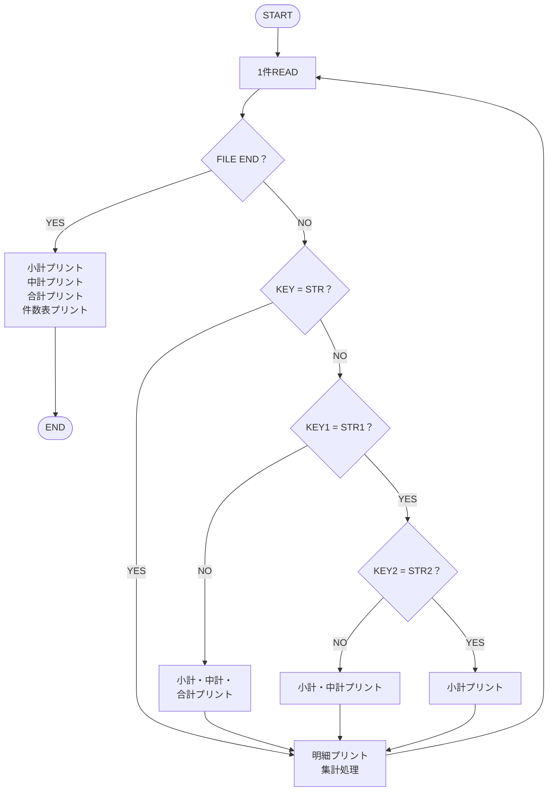

**処理の流れ:**

このコントロールブレイクは、小計・中計・合計をコントロールする処理である。

① **1件目のREAD時** にデータ中のKEYをワークエリアで取ったKEYとSTRにMOVEする。1件目以外はKEYへ入れる。

② **FILE ENDか** を確認する。ENDならば、小計・中計・合計をプリントし、件数表をプリントしてEND処理を行い、プログラムはストップする。ENDでなければ③へ。

③ **KEYとSTRを比較** して、同じならば明細をプリントして集計処理を行い①へ戻る。

④ **大項目KEY（KEY1、STR1）が同じでなければ** 小計・中計・合計をプリントし、KEYの内容をSTRにMOVEする。

⑤ **中項目KEY（KEY2、STR2）が同じでなければ** 小計・中計をプリントし、KEY2の内容をSTR2へ、KEY3をSTR3へMOVEする。

⑥ **小項目KEY（KEY3、STR3）が同じでなければ**（実際には比較する必要はない）、小計をプリントしKEY3をSTR3へMOVEする。

⑦ ④⑤⑥の処理が終ったら、明細をプリントし集計処理をして①へ戻る。

> 明細はREADしたデータ。小計・中計・合計は、READしたデータの1件前までの集計した値である。だから、ラストの時に明細をプリントする必要はない。

---

### コーディング例（MAIN）

```cobol
10     S01-START.
20         PERFORM            S02-INITIAL THRU S02-EXIT.
30     S01-01.
40         PERFORM            S03-READ THRU S03-EXIT.
50         IF                 SW-END = '1'
60           GO TO            S01-02
70         ELSE
80           IF               KEY = STR
90             NEXT SENTENCE
100        ELSE
110          IF               KEY1 = STR1
120            IF             KEY2 = STR2
130              PERFORM      S06-SHOKEI THRU S06-EXIT
140
150            ELSE
160              PERFORM      S06-SHOKEI THRU S06-EXIT
170              PERFORM      S07-CHUKEI THRU S07-EXIT
180
190          ELSE
200            PERFORM        S06-SHOKEI THRU S06-EXIT
210            PERFORM        S07-CHUKEI THRU S07-EXIT
220            PERFORM        S08-GOKEI THRU S08-EXIT.
270        PERFORM            S04-MEISAI THRU S04-EXIT.
280        PERFORM            S05-SHUKEI THRU S05-EXIT.
290        GO TO              S01-01.
300    S01-02.
310        PERFORM            S06-SHOKEI THRU S06-EXIT.
320        PERFORM            S07-CHUKEI THRU S07-EXIT.
330        PERFORM            S08-GOKEI THRU S08-EXIT.
340        PERFORM            S09-KENSUHYO THRU S09-EXIT.
350        PERFORM            S10-CLOSE THRU S10-EXIT.
360        STOP RUN.
```

マッチング処理中にコントロールブレイク処理が入るというような処理は非常に多い。マッチング処理とコントロールブレイク処理は、単純なTAPE TO PRINTのような処理以外は入っているとみて良いだろう。それだけに、この2つの処理はしっかりと身につけておいて欲しい。

---

## 第七章 TSO

ここではTSOのまわりのファイルと、TSOでテストする場合とJCLとの違い、コマンドプロシジャーの基本的なものの作成方法を簡単に述べる。詳細はプログラマーズハンドブックを参照して頂きたい。

### TSOのLOGON

LOGONとは、ユーザーがワークを確保して作業が行える様にする第1番目のコマンドである。

```
LOGON USER-ID/PASSWORD ↵
```

例:

```
LOGON @QAKOBA/1111 ↵
```

このコマンドを入れるとTSOの画面はREADYになり使用可能となる。

### 1. TSO周辺のファイル関係図

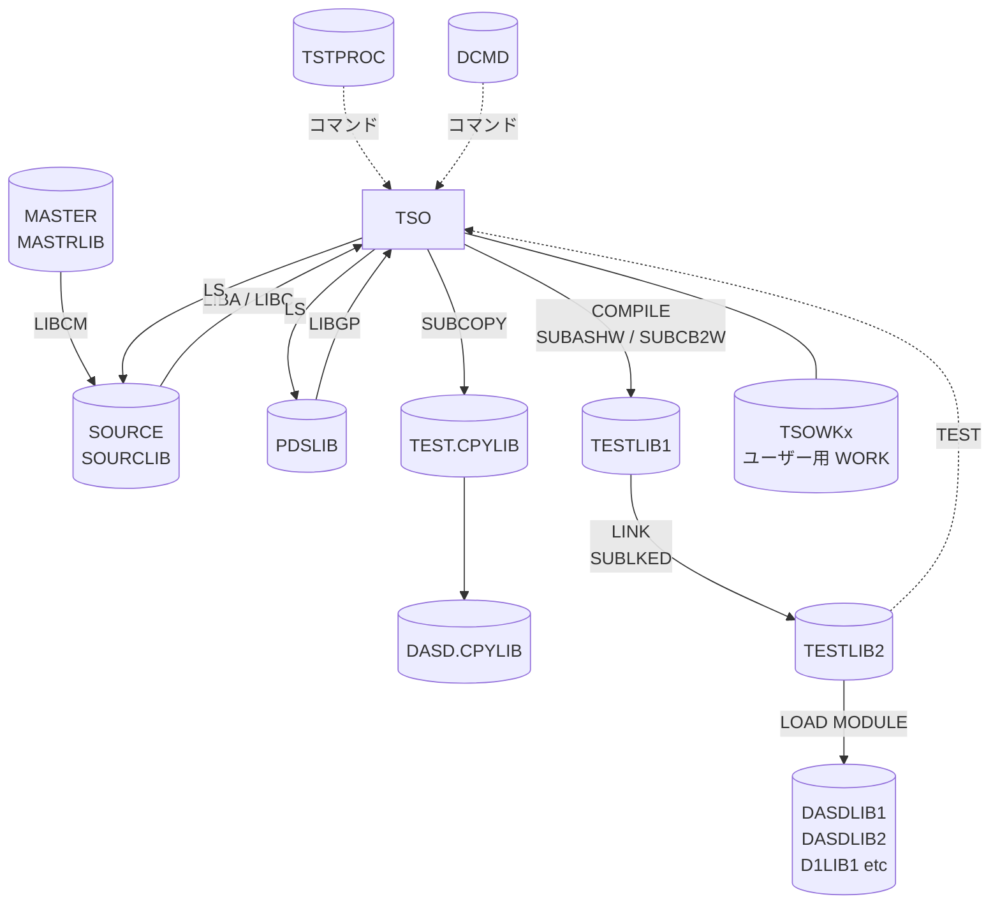

TSTPROC・DCMDはコマンドプロシジャーを登録しておくライブラリで、ここからTSOへコマンドが提供される。TSOワークはTSOWKxとして確保される。

### 2. ファイル説明

| ファイル | 説明 |
|----------|------|
| **MASTRLIB** | 最終的なソースプログラムがSOURCEからコピーされて登録されている |
| **SOURCLIB** | パンチされたプログラムが入り、修正などが行われて更新されていくプログラム。定期的にスクラッチされる |
| **PDSLIB** | DCOPY文のソースが入っている |
| **TEST.CPYLIB** | TSOよりSUBCOPYされたDCOPYが一時的に入れられる所。毎週月曜日にスクラッチされる |
| **DASD.CPYLIB** | 完成されたDCOPYがTEST.CPYLIBよりコピーされて入る所 |
| **TESTLIB1** | TSOよりCOMPILEされたものが入る（通常） |
| **TESTLIB2** | TESTLIB1へカタログしたモジュールを、単体ならそのまま、そうでなければ他のモジュールをリンクしロードモジュールを一時的にカタログしておく所 |
| **DASDLIB1/2、D1LIB1** | 最終的なロードモジュールがカタログされる |

### 3. ソースからロードモジュールまで

1. コーディングを終えてパンチに出すとまずソースリブに登録される
2. TSOから `LIBC`、`LIBA` のコマンドによってソースリブからTSOワーク上（TSOWKx）に持ってくる。ここで修正を加えて `SUBCB2W`、`SUBASHW` などのコマンドによりコンパイル、またはアセンブルを行う。TESTLIB1へカタログされる
3. TESTLIB1にカタログされたモジュールと他のモジュールを連結する（リンク）。TESTLIB1のモジュールが他のモジュールを必要としていなければ（CALL命令がなければ）リンクする必要は無い。このリンク処理を行うコマンドとして `SUBLKED` などがある
4. リンクされたモジュールは一時的にTESTLIB2へカタログされる（ロードモジュール）
5. このロードモジュールをTEST命令などでテストを繰り返す。エラーが無くなるまで手順2〜4を繰り返す
6. 完全に出来上がったロードモジュールは業務によって `DASDLIB1`、`DASDLIB2` などに `TESTLIB2` から登録される
7. これで動かせるモジュールができた

### 4. JCLとTSOのテストの違い

**JCLの場合:**

```
// SAMPLE      JOB NSD,MSGLEVEL=1
// JOBLIB      DD  DSN=TESTLIB2,DISP=SHR
// STEP1       EXEC PGM=SAMPLE,PARM='8106'
// INFL        DD  DSN=TEST.DATA,
//                DCB=(BLKSIZE=1000,LRECL=100,RECFM=FB),
//                VOL=SER=DTF005,UNIT=3350,
//                DISP=SHR
// PRINT       DD  SYSOUT=A
// SYSOUT      DD  SYSOUT=A
// SYSUDUMP    DD  SYSOUT=A
```

**TSOの場合:**

```
FREE F(INFL,PRINT,SYSOUT)
ALLOC F(INFL) DA('TEST.DATA') VOL(DTF005) -
  UNIT(3350) SHR
ALLOC F(PRINT) -DA(*)
ALLOC F(SYSOUT) -DA(*)
TEST 'TESTLIB2(SAMPLE)' '8106'
```

これだけKEYINするとTSO画面上にTESTという文字が出てくる。ここでGOというコマンドを入れるとプログラムは作動する。テストがうまく行くと結果が画面に現れる。

### 5. TSOモード関係図

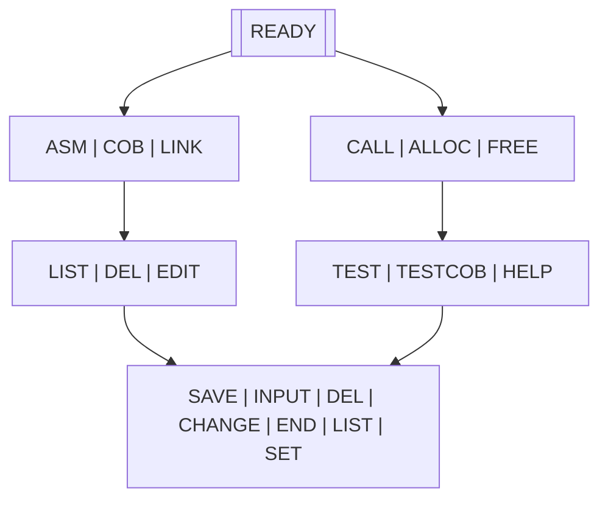

左側はコンパイル・リンク系のモード、右側はファイル制御・テスト系のモードで、どちらも最下層のモード群を支える上下関係になっている。

### 6. CLISTの作り方

TSO画面上に `READY` と出たら何もやっていないという状態である。まずコマンドプロシジャーを作る。

```
EDIT MIHON.CLIST NEW ↵ E ↵
```

（名前は何でもよい。8桁以内）KEYINすると画面に `INPUT` と出る。ここで、前頁でテストする為に入れたコマンドをそのまま1ラインずつKEYINする。

```
INPUT
000010 FREE F(INFL,PRINT,SYSOUT)    E
000020 ALLOC F(INFL) DA('TEST.DATA') -    E
...
000060 TEST 'TESTLIB2(SAMPLE)' '8106'    E
000070                    E
```

ENTER-KEYを押すとINPUTモードからEDITモードになり、`EDIT` と画面に出る。ここで `END SAVE ↵` とKEYINするとモードはREADYになる。

これで、初めに `MIHON.CLIST` とKEYINしたものの中身ができた事になる。後はこれを作動させてTESTモードにすればいいのである。

実行には、次の様にKEYINする:

```
EX MIHON ↵
```

TESTモードになり画面にTESTと出る。何回もKEYINすることを解消したわけである。なお、このコマンドプロシジャーをTSTPROCに登録すれば `EX` を付けずに `MIHON` と打ち込むだけで作動する。

これが最も基本的なコマンドプロシジャーである。このコマンドプロシジャー内で様々な処理を行わせる事もできるが（IF＆SET etcを使って）それは省略しておく。ここではJCLとコマンドプロシジャーの違いを知っておいてもらいたい。

### 7. TSOの主なコマンド

**LIBC / LIBA / LIBGP**

```
LIBC   ********
LIBA   ********
LIBGP  ********
       管理コード8桁
```

このコマンドの基本は下記のLGコマンドである。

**LG**

```
LG ******** { COBOL } DSSOURCE( { MASTRLIB } )
            { ASM   }           { SOURCLIB }
            { DATA  }           { PDSLIB   }

   PASSWORD(****)
```

上記のコマンドは、ソースリブなどからソースモジュールをTSOワーク上へ持ってくるコマンドである。

**SUBCB2W / SUBASHW / KCOBJ / KC**

```
SUBCB2W  ********   RM(**)
SUBASHW  ********   RM(**)
KCOBJ    ********   RM(**)
KC       ********   RM(**)
   管理コード8桁    **=RM1,RM2,C
```

上記のコマンドは、モジュールをコンパイルもしくはアセンブルしてTESTLIB1（基本的に）へカタログする。このコマンドにはオプションが幾つかあるが、それは省略する。

**SUBLKED / SUBLKED2 / KLKED**

```
SUBLKED   ******
SUBLKED2  ******   通常6桁指定
KLKED     ******
```

上記のコマンドはリンクする為のコマンドである。TESTLIB2（基本的に）へカタログされる。

**LS、LS =ALL**

TSOワークへ持ってきたモジュールをソースリブなどへ戻してやるコマンドである。

---

## 第八章 PAD図

### 1. PAD図（1:1マッチング、スイッチ使用）

*原見出し: 1、36ページのPAD図（1:1マッチング、スウィッチ使用）*

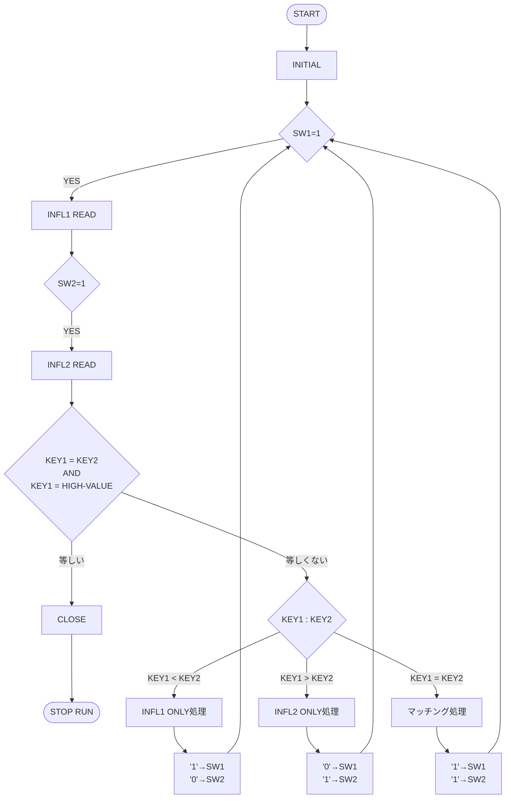

### 2. PAD図（1:1マッチング、スイッチ不使用）

*原見出し: 2、38ページのPAD図（1:1マッチング、スウィッチ不使用）*

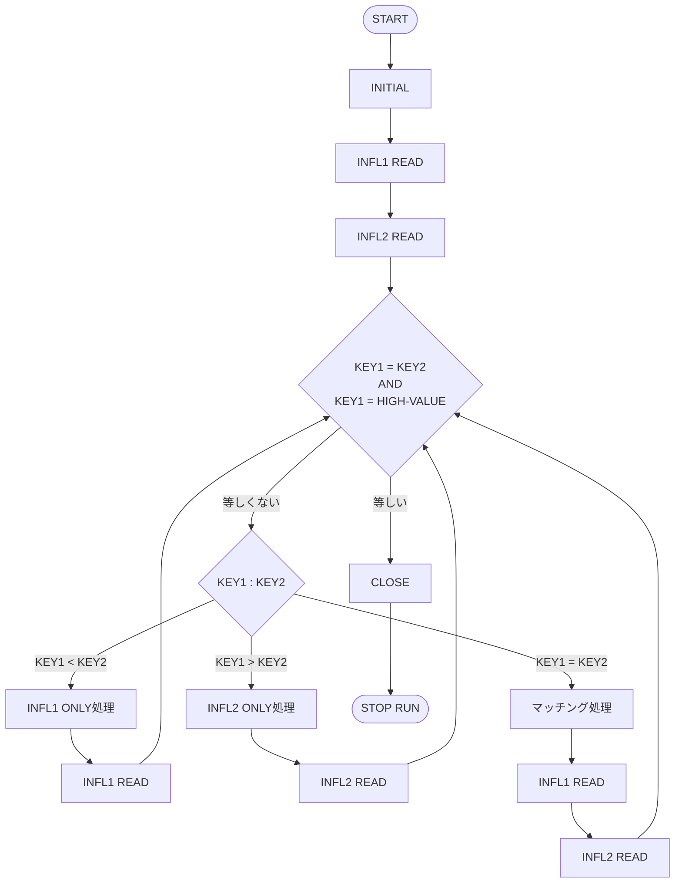

### 3. PAD図（1:Nマッチング、スイッチ不使用）

*原見出し: 3、39ページのPAD図（1:Nマッチング、スウィッチ不使用）*

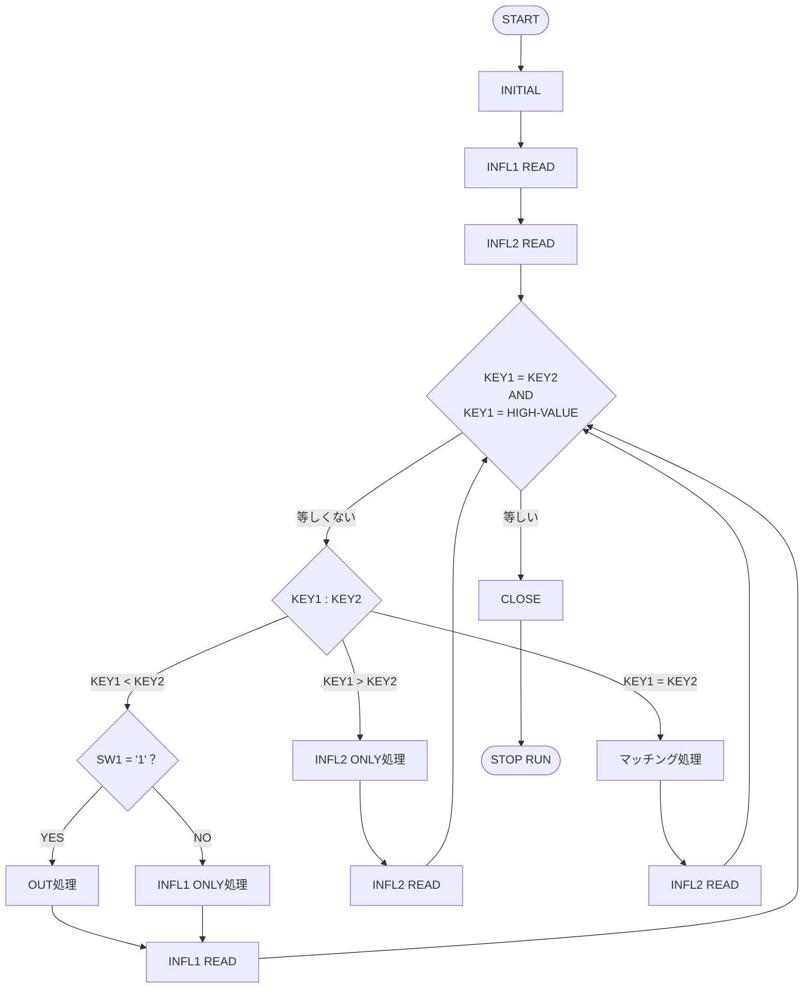

### 4. PAD図（N:Nマッチング）

*原見出し: 4、40ページのPAD図（N:Nマッチング）*

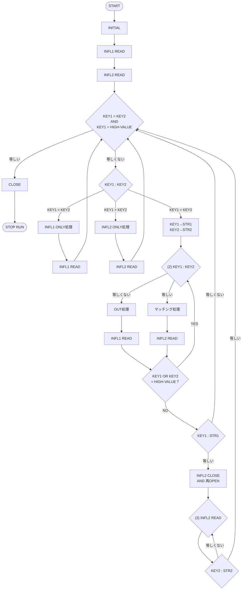

### 5. PAD図（コントロールブレイク）

*原見出し: 5、43ページのPAD図（コントロールブレイク）*

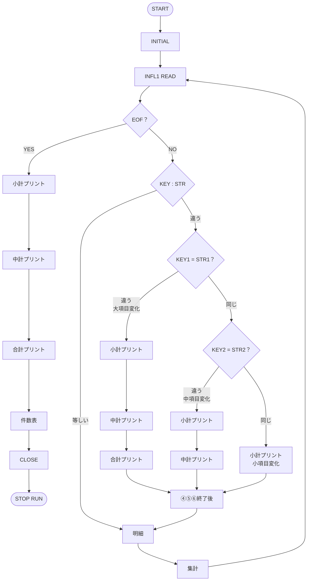

---
---

## 付記（デジタル化に際して）

- **ページ対応**: 原PDFのページ番号と本文の印刷ページ番号は「印刷ページ ＝ PDFページ − 3」の関係にある（PDF 5ページ目 = 本文 − 2 −）。第八章のPAD図のページ（印刷 − 58 −〜 − 62 −）は横向きにスキャンされている。
- **原文の表記どおり**に写した箇所: 第三章 (5) FILE-CONTROL の形式一覧の「ATCUAL KEY 文節」（ACTUAL KEY の誤記）、第八章 PAD図中の「HIGT VALUE」「GLOSE」など。旧式のタイプライター打ちのため、この種の誤記が原文に存在する。
- **PICTURE句の通貨記号**は原文どおり `¥` とした（原文のタイプライターは `¥` キー）。
- **2進数の指定**「COMP-8」は原文表記のまま。IBM COBOLでは2進（バイナリ）は `COMP`（`COMP-2`）である。
### COBOLコードの整桁規約

本書のCOBOLコードは、下記の規約で整桁している（語句そのものは原文のまま。追加したのは空白のみ）。

**データ部**

| 欄 | 開始位置 | 内容 |
|---|---|---|
| レベル欄 | 入れ子1段につき+2桁 | 2桁のレベル番号 + 2空白 |
| 項目名欄 | レベル欄+4桁目 | 項目名・FD名 |
| **句欄** | **25桁目に固定** | `PIC` `OCCURS` `INDEXED BY` `VALUE` `REDEFINES` `RECORDING MODE` などの句 |
| **値欄** | **句欄+14桁（39桁目）** | 句の直後の値・項目名・リテラル |
| 3列目以降 | 固定なし（2空白） | `TIMES` `MODE IS F` など |

```cobol
FD  INFL                RECORDING MODE   IS F
                        RECORD CONTAINS  20 CHARACTERS
01  IN-REC              PIC              X(20).
  05  IN-KBN            PIC              X(5).
```

**手続き部**（`GO TO` `MOVE TO` などの命令文）

| 欄 | 開始位置 | 内容 |
|---|---|---|
| 命令欄 | 段落名より2桁インデント（入れ子1段ごとに+2桁） | 命令語。`GO TO` `AT END` `ON SIZE ERROR` `STOP RUN` は1句として扱う |
| 値欄1 | 命令欄 +（最長命令語）+ 2桁 | 第1オペランド |
| 前置詞欄 | 値欄1 +（最長オペランド）+ 2桁 | `TO` `FROM` `BY` `INTO` `GIVING` `THRU` `UP BY` `DOWN BY` `UPON` |
| 値欄2 | 前置詞欄 +（最長前置詞）+ 2桁 | 第2オペランド |
| 以降 | 固定なし（2空白） | `[ROUNDED]` `SW-END = 'E'.` など |

```cobol
MOVE  ZERO  TO     A B C.
MOVE  A     TO     B.
SET   IDX1  TO     1.
SET   IDX1  UP BY  1.
ADD   A B   TO     (B) ROUNDED.
```

**共通**

- 項目名が25桁目に達するブロックでは、句欄を（名前の末尾+3桁）まで押し下げ、句欄・値欄はブロック内で同一位置に揃える
- 句欄幅は標準14桁。`RECORDING MODE`（15桁）などを超えるブロックは（最長句+2桁）に拡張
- 注釈（`←` `→`）は本文の最大幅+3桁に揃え、72桁を超える場合は直後3空白に置く
- 構文の「形式」ブロックも同じ列に揃える。ただし `{ }` `[ ]` の選択肢-group は構造を保ち、継続行は直前行の同じ括弧の桁に揃える。桁計算は全角=2桁の表示幅で行う（半角のみで数えると全角ぶんだけずれる）。選択肢-group の開き括弧の前も 2空白あける
- フィールド間は必ず半角2つ以上。タブは使用しない。コードブロック内の行は表示幅72桁以内（実測 最大64桁）
- 手続き部は段落名のあるブロックで命令欄を+2桁とし、入れ子関係は相対インデントで保つ（整形の再実行でインデントが増えない）
- **対象外**: JCL・TSOコマンド・CLIST・端末出力例・図解（矢印・枠線を含むブロック）、および「…文節」の列挙のみからなる一覧ブロック

- 第五章の命令一覧、第七章 TSOのファイル関係図・モード関係図、第八章のPAD図は、原文の図をMermaidのフローチャートで再現したものである。PAD図そのものはN-S図（ボックス図）の表記であり、条件分岐を示す三角記号は「条件が真の時に右側（後続）の処理を実行する」と読み替えている。
